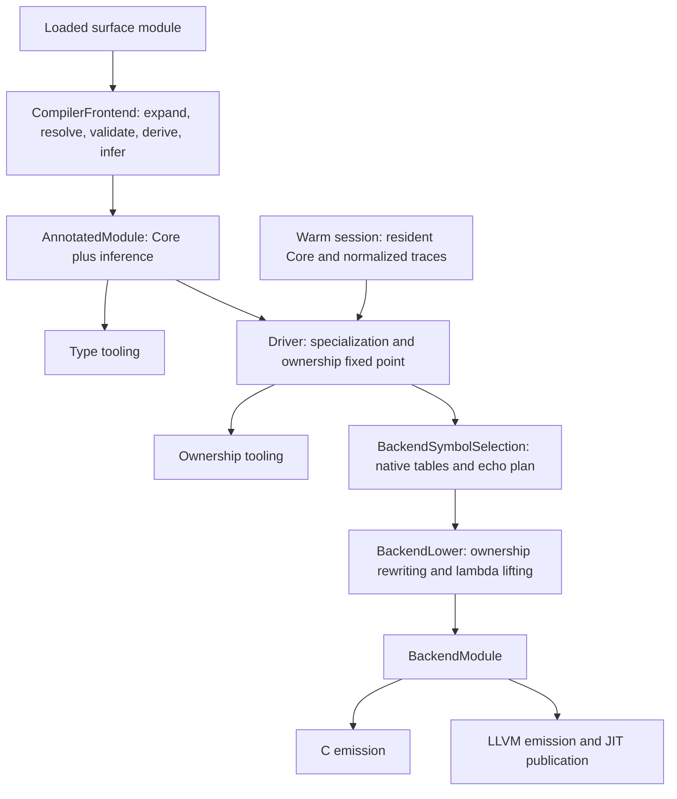

# Compiler phase boundaries

The compiler uses one preparation path and one concrete lowering path.
`CarpCompiler` remains the facade for existing callers; semantic passes live in
the libraries that own their inputs and invariants.

## Preparation

`carp-frontend/carp-frontend.carp` loads the reader, expansion, resolution,
inference, derivation, and validation libraries. It has no backend dependency.
Batch lowering, library compilation, and ownership tooling call its common
`infer-module-with`. This path owns validation and phase-tagged diagnostics,
including the check for duplicate global identities after derivation.

Derivation is separate from orchestration. Its pass order remains semantic:
accessors precede copies, copies precede deletes, and generic string fallbacks
precede concrete generic closure. `DeriveContext` contains each invocation’s
identity policy and the IDs of generated string functions. Those fields no
longer live in process globals or require temporary global policy changes.
Registered foreign-type derivation belongs to this same library.

Concrete field-type instantiation belongs to `CoreInstantiation`, an optional
bridge between Core IR and the type algebra. Derivation, specialization, C
layout, and LLVM layout share one structural walk. Their variable lookup policies
retain distinct binding precedence, recovery, and diagnostics. Binding storage
is borrowed; inference retains its own fresh-variable and lifetime conversion.
Ownership classification uses this bridge too, preserving its variable-zero
recovery for unresolved declared types.

## Owned handoffs

Preparation consumes intermediate modules at function boundaries so an earlier
full-program representation does not remain alive through later phases.
`CoreIR.index-call-sites` consumes its input and replaces only functions,
values, and roots. The ten unchanged declaration arrays keep their storage.
A derivation preserving provenance returns its constructed module directly. Prepared and lowered records are unpacked with owned constructor patterns, transferring their Core, inference, backend, and instance-cache fields into the next stage.

`RefLift` belongs to ownership preparation. Its source-map identity policy is
an explicit argument to `module-with-source-map`; the standalone `module`
entry uses owner-local generated IDs. The pass no longer reads driver state.

Backend lowering consumes lambda lifting's owned module and closure array.
Cleanup replaces each body expression in its existing record, releasing the
previous tree before the next body. Body and closure arrays, signatures,
parameters, capture descriptions, and specialization metadata retain their
storage. Root rewriting replaces only the root array.

Ordinary functions and lifted closures share parameter/local delete partitioning,
array hoisting, and cleanup insertion. Context selection still distinguishes
generic closure instances, and only parameter deletes at the body root become
exit cleanup. The public lowering entry points continue to borrow their inputs.

Binding deletes are resolved once before rewriting, separating fallible symbol
resolution from body, root, and closure transformation. Cleanup uses the same
stable integer-position grouping as specialization, so each concrete context
selects its own deletes without scanning the complete ownership action list.
Negative contexts retain the original action order across all contexts. The
resolved plan and its index are released before backend materialization.

## Planning and emission

The driver creates one `SpecializeContext` for each fixed Core/inference
input and shares its indexes across named roots, ownership-closure rounds,
and echo demands. Each specialization call owns temporary work separately:
its normalized types, dispatch memo, and worklist buckets are released before
ownership planning. Context and work travel as separate references, so the
ownership checker can track their lifetimes. Normalized-type slots are lazy
and untouched slots own no boxed types.

The driver owns the specialization/ownership fixed point. Ownership reports
concrete delete requirements; capture analysis adds copier and deleter demands
for owned closure environments. `SpecializationDemands` owns separate type-key
sets and ordered copier and deleter requests for that closure. Each accepted
request is constructed once and retained across rounds. Specialization borrows
the streams and appends them directly to its work queue, followed by named
seeds. Capture analysis submits borrowed types to the same accumulator without
building another deduplicated type array. The driver still owns convergence;
neither ownership nor specialization starts another closure loop.

`ConcretePlan` owns the closed specialization delta, ownership plan, complete
instance cache, and accepted echo type keys. Specialization output is unpacked with
an owned constructor pattern, transferring its module and cache into planning.
Echo augmentation consumes this plan and returns it directly when no echo
demands exist. Backend symbol selection resolves the final native tables and
echo plan once. Lowering consumes those symbols and the concrete plan, transferring
the cache into `IncrementalLowering`. These handoffs replace nested pairs and
whole-result copies; ownership tooling uses the same closure entry point.

`BackendSymbolSelection` owns this selection policy. It indexes the complete
identity of each implementation reference, combining its copier, deleter, and
string roles, then walks concrete instances once. The temporary index is
released before lowering. Deleters retain unary argument keys, copiers retain
return keys, and echo retains instance order and its actual borrowing convention.
The driver collects accepted echo keys without retaining MonoType copies or
re-keying every prior echo type at each root.

`PatternTyping` owns constructor-driven pattern payload types and masked
binding of ignored slots. Ownership obtains bound and ignored types together,
so a by-value branch traverses its pattern and copies its scrutinee type once.
Lowering requests only ignored slots. The specialization pattern entry points
remain compatibility facades; the shared library loads without specialization.

`CaptureAnalysis` borrows the concrete IR and finds free local bindings. It is
shared by the driver and lambda lifter. Planning runs it once per fixed-point
iteration, without creating lifted bodies, closure constructors, or native
symbols. Actual lambda lifting happens during backend lowering. C and LLVM
continue to consume the existing `BackendModule`; no additional emission IR
or generated schema was added.

C expression rendering borrows its `BackendModule` through recursive calls.
Constructors and managed-symbol tables come from that module, including when
rendering function sections directly. Lowering no longer seeds a C copier
global, and translation-unit rendering no longer copies deleters into one.
`CAbi.symbol-for-key` and `symbol-for-type` own native table lookup, preserving
exact keys, last-entry precedence, and raw symbols. C identifier normalization
remains in the renderer; LLVM and planning use the same lookup policy.

`BackendLineMap` owns location lookup for both backends. C reads the map from
its borrowed module, including standalone function and constructor sections.
Rendering another module cannot replace those locations or enable directives
for an unmapped module. The C emitter no longer copies three map arrays or
keeps a global enable flag and unused last-location cursor. LLVM still owns
its separate per-emission debug caches and map snapshot.

Batch, rooted library, and incremental lowering use the same ownership closure,
echo augmentation, symbol resolution, and backend handoff. Their differences
are explicit roots, known concrete instances, and echo policy.

## Inference and session storage

`carp-infer/analysis.carp` owns trace normalization, joining, and append-only
checkpoints. `NormalizedAnalysis` has no solver substitution. Joining accepts
normalized inputs; joining raw results first applies each result’s own
substitution. Ordinary batch inference retains its substitution unchanged.
The session caches normalized base analysis once and only normalizes its small
transient delta on warm lowering.

Core storage likewise belongs to CoreIR. Sessions coordinate Core and inference
checkpoints and retract both after successful or failed transient lowering.
Marks support nested append-only transactions on the same resident value;
they do not restore edits to pre-existing entries.

## State and compatibility

The compiler and session facade entry points retain their existing arguments
and results. Internal derivation passes now require a `DeriveContext`, and
`CoreIR.index-call-sites` takes an owned module instead of a reference.

This establishes invocation-owned derivation state and read-only planning
analysis. Other services still carry process state, including expansion,
resolution, specialization naming defaults, source maps, and backend emission. They still
require serialized invocations; this change does not make the whole compiler
concurrent.
